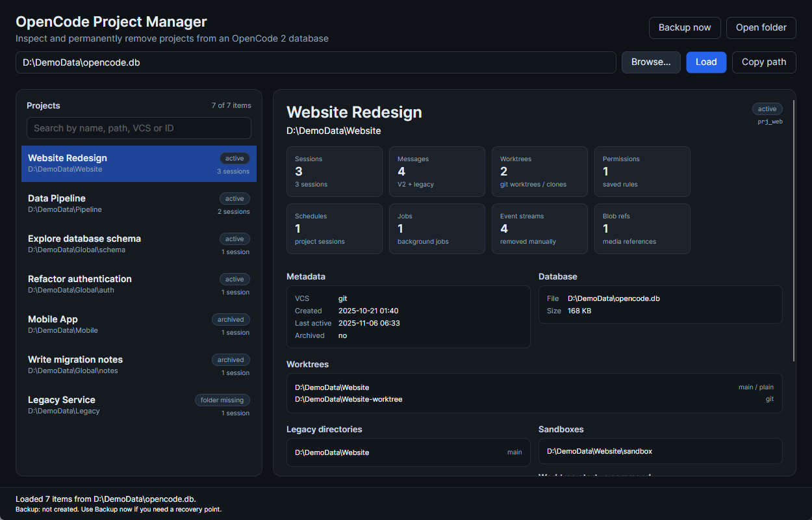

# OpenCode Project Manager

A small **C# + Avalonia** desktop application for inspecting and permanently deleting projects from an **OpenCode 2** SQLite database.

It works directly with `opencode.db`: validates the schema, shows projects and global sessions with their related rows, blocks writes while OpenCode is running, creates backups on demand, and can compact a bloated database file.

> This is a standalone utility, not an OpenCode plugin or a patch for OpenCode. It never deletes project folders or any other files on disk — only rows in the OpenCode database.



## Features

- Automatic database discovery and manual file selection.
- Schema validation before any change.
- Project list with search and detailed metadata.
- Permanent project or global-session deletion with a confirmation dialog.
- On-demand backups.
- Database compaction (`VACUUM`) with a confirmation dialog.
- Write blocking while OpenCode is running, plus a read-only mode.

## Requirements

- .NET SDK **10.0** or newer.
- Windows, Linux or macOS (Avalonia Desktop).
- A current OpenCode 2 database schema.

## Build and run

```powershell
dotnet build src/OpenCode.ProjectManager.slnx
dotnet run --project src/OpenCode.ProjectManager
```

Run against a specific database:

```powershell
dotnet run --project src/OpenCode.ProjectManager -- "C:\Users\you\.local\share\opencode\opencode.db"
```

## Documentation

- [Usage](docs/usage.md)
- [Database schema and deletion](docs/database.md)
- [Backups and compaction](docs/database-maintenance.md)
- [Development](docs/development.md)

## Tests

```powershell
dotnet test src/OpenCode.ProjectManager.slnx
```
